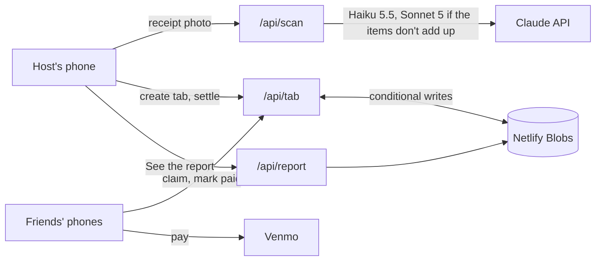

# Tab

Split any tab in the same sitting. The person who paid snaps the receipt, everyone else opens a link,
taps their name and claims what they had, and pays back on Venmo with one tap. Tax, fees and tip are
split in proportion to what each person had. Friends never need an account or an app.

It started as a one-off for a dinner on October 17 (hence the repo name) and became a general-purpose
bill splitter: a no-build web page, three Netlify Functions, and Claude reading the receipt.

## How a tab goes

1. **The host snaps the receipt** (or types it). Claude reads the lines; the host checks them, enters
   what the card was actually charged, adds who was there, and picks **itemized** or **even split**.
2. **Everyone opens the tab's link** (`/t/<tab id>`), taps their name and claims what they had. Shared
   items split evenly among whoever claimed them. In an even split, people mark only what they skipped.
3. **Everyone pays on Venmo.** The button opens Venmo with the amount and a note filled in. Their total
   locks the moment they pay, so later changes on the tab can't move it.
4. **The host tidies up.** Anything nobody claimed shows as "not covered" until the host assigns it,
   splits it across everyone who hasn't paid yet, or covers it. **Remind privately** shares a
   link that opens straight to their own share (`?p=<person>`).

The host's controls sit behind a private host key in their link (`#h=<host key>`), saved on their
phone. Nobody else can change the receipt, the people or the split.



## Under the hood

- **One source of truth for the math.** `public/split.mjs` is the split logic, imported by both the
  page and the server, so the total on your phone and the total the server stores always match. All
  amounts are whole cents, and everything beyond the items (tax, fees, tip) is "what the card was
  charged minus the items", shared in proportion.
- **Simultaneous taps don't clobber each other.** Each tab is one JSON document in Netlify Blobs,
  written with conditional (ETag) writes, so five people claiming at once from five phones all land.
- **Receipt reading that checks itself.** Claude Haiku 5.5 reads the photo through a forced tool call
  that returns structured lines. If the items don't add up to the receipt's subtotal, Claude Sonnet 5
  rereads it; if both miss, the result comes back flagged for the host to fix. Reading stops for the
  month at a credit cap (`SCAN_CREDIT_CAP`, default 30), so a busy month can't run up the bill.
- **A report for the host.** Each tab keeps an event log that phones never receive. `/api/report`
  turns it into milestones and metrics (time to settled, share paid within 2 hours, and so on) behind
  the tab's "See the report" button.
- **No framework, no build step.** The page is plain HTML and ES modules served from `public/`. The
  only dependency is `@netlify/blobs`.

## Put it online (from your phone)

1. Go to app.netlify.com and sign in.
2. Tap **Add new project → Import an existing project → GitHub**, allow access, and pick this repo.
3. Leave every setting as it is (`netlify.toml` already has them) and tap **Deploy**.

Netlify provides the Claude API key to functions on its own (`ANTHROPIC_API_KEY`,
`ANTHROPIC_BASE_URL`); set them yourself to use your own key. Pushing to `main` redeploys to
production (15 credits each on the free plan). Pull requests get a free preview link instead, so test
there first. Deploy previews use their own storage, so trying a preview never changes live tabs.

## Tests

```bash
npm test
```

Plays tabs through the server code: host-only actions, locks, leftovers, even split, to-the-cent checks
on 3,000 random tabs, receipt reading (with both models faked) and the monthly cap.

```bash
npm i --no-save jsdom && npm run test:page
```

Drives the real page through a whole tab on three simulated phones.

## What's where

| File | What it does |
| --- | --- |
| `public/index.html`, `public/app.mjs` | the page |
| `public/split.mjs` | the split math, shared by the page and the server |
| `netlify/lib/core.mjs`, `netlify/functions/tab.mjs` | the tab API at `/api/tab` |
| `netlify/lib/store.mjs` | Netlify Blobs storage (separate per deploy preview) |
| `netlify/lib/read-receipt.mjs`, `netlify/lib/scan.mjs`, `netlify/functions/scan.mjs` | receipt reading at `/api/scan` |
| `netlify/lib/report.mjs`, `netlify/functions/report.mjs` | the host's report at `/api/report` |
| `tests/run.mjs`, `tests/page.mjs`, `tests/fake-store.mjs` | the server tests and the three-phone page test |
